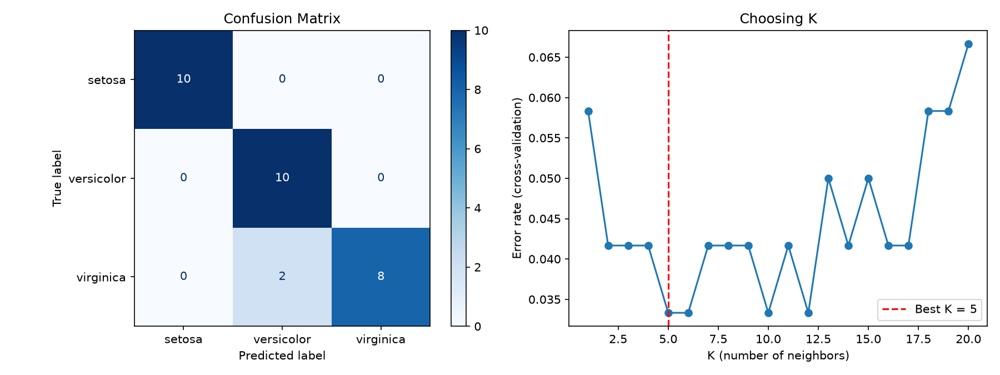

# 🌸 Iris Data Classification with KNN

A supervised machine learning project that classifies iris flowers into three species using the K-Nearest Neighbors algorithm. Built as **Project 2** of the DecodeLabs AI Engineering internship.

## 📌 Description

The program loads the classic Iris dataset, prepares the data, trains a KNN classifier, and evaluates it with a confusion matrix and precision, recall and F1 scores. It follows a clear Input → Process → Output pipeline.

| Dataset fact | Value |
|---|---|
| Samples | 150 (50 per class) |
| Features | 4 (sepal length, sepal width, petal length, petal width, all in cm) |
| Classes | 3 (setosa, versicolor, virginica) |

## 🧠 Pipeline

1. **Input**
   - Load the dataset and inspect it (shape, class counts, missing values, statistics)
   - Scale the features with `StandardScaler` (fitted on training data only to avoid data leakage)
2. **Process**
   - Shuffled, stratified 80/20 train-test split
   - Choose the best `K` using 5-fold cross-validation on the training set
   - Train `KNeighborsClassifier` (instantiate → fit → predict)
3. **Output**
   - Accuracy, confusion matrix, and a classification report (precision / recall / F1)
   - Saved chart: `iris_results.png`
   - Prediction for a brand-new flower

## 📊 Results

| Metric | Score |
|---|---|
| Accuracy | 93.3% |
| Macro F1 | 0.933 |
| Best K | 5 |

Setosa was classified perfectly. The only errors were two virginica flowers predicted as versicolor, which is expected because those two species overlap.



> Results can vary slightly if you change the random seed or the split.

## ▶️ How to Run

**Requirements:** Python 3.8 or higher

```bash
# 1. Clone the repository
git clone https://github.com/<your-username>/<your-repo-name>.git
cd <your-repo-name>

# 2. Install the libraries
pip install scikit-learn pandas matplotlib

# 3. Run the project
python iris_classifier.py
```

The results print in the terminal and a chart opens. Close the chart window to finish. The chart is also saved as `iris_results.png`.

## 🛠️ Tech Stack

Python · scikit-learn · pandas · NumPy · Matplotlib

## 🚀 Future Improvements

- Compare KNN with Decision Tree and Logistic Regression
- Test on a larger, real-world dataset
- Move on to deep learning and computer vision (next topics in the course)

## 👤 Author

**Gullshair Ahmed**
Software Engineer | Portfolio: [gullshair-ahmed.netlify.app](https://gullshair-ahmed.netlify.app)
Built during the DecodeLabs AI internship (Batch 2026).
